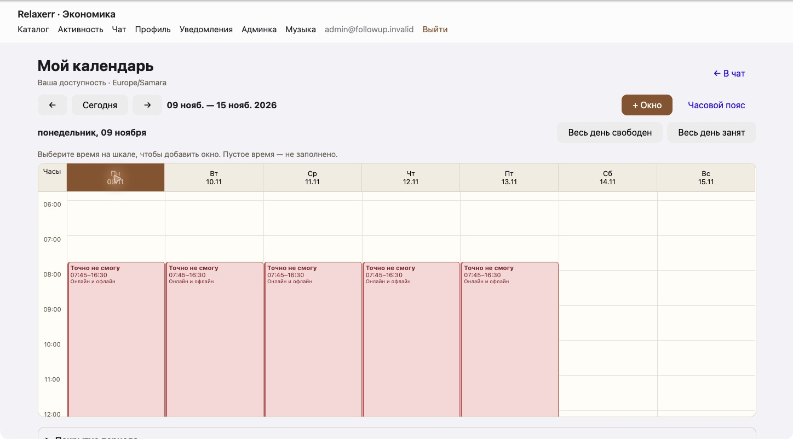
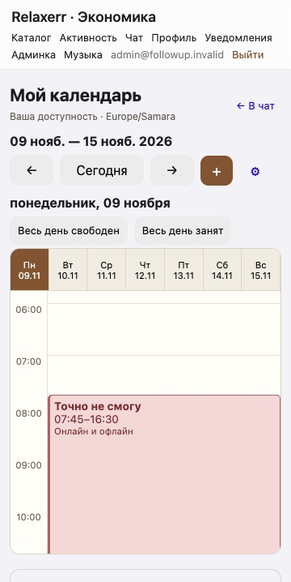
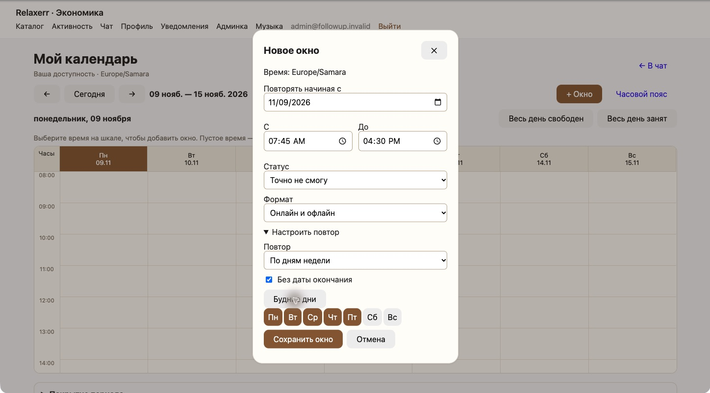
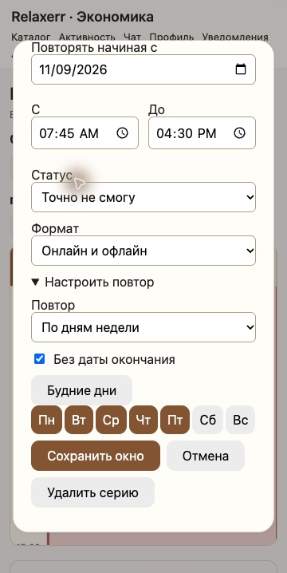
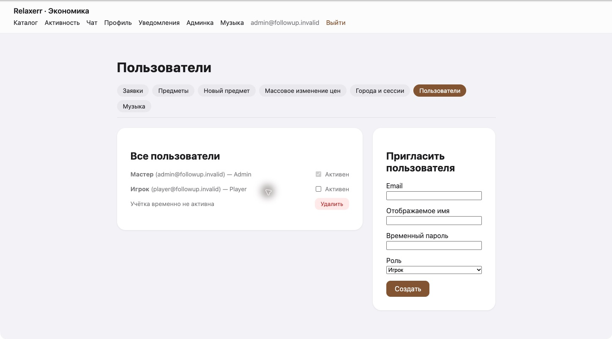
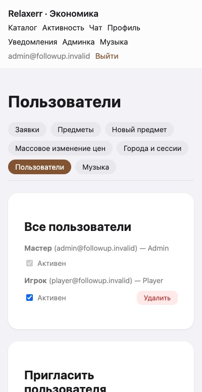
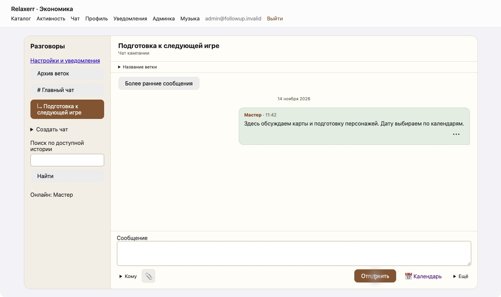
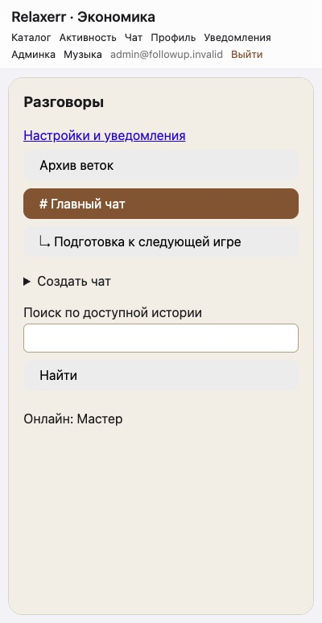

# Повторы, выбор дня, активность учёток и названия веток

## Изменения

- Даты и время в редакторе доступности разделены. Например: начало действия —
  16.11.2026, время — 07:45–16:30, статус «Точно не смогу», повтор по дням недели,
  кнопка «Будние дни», флажок «Без даты окончания».
- У конечной серии отдельно задаётся последний день повтора, включительно.
  Равное или более раннее время окончания у повтора означает окончание на следующий день.
- Семь кнопок дней находятся в закреплённом заголовке самой сетки. На телефоне они
  переключают видимую шкалу; на десктопе выбирают день для действий «Весь день».
  Второй набор кнопок над таблицей удалён.
- В `/admin/users` есть флажок «Активен». Отключение обратимо, себя отключить нельзя.
  Вход с верным паролем сообщает: «учётная запись временно не активна».
- Отключение отзывает сессии, убирает игрока из адресатов, онлайн-статусов,
  уведомлений и подбора. Текущий раунд не ждёт его ответа и не учитывает его голос.
  Календари, сообщения и прочие исторические данные сохраняются.
- Ветки называются по исходному сообщению. Старые безымянные ветки также получают
  различимое превью. Участник доступной ветки может изменить её название из шапки
  разговора; переименование не меняет приватность.

## Реализация и миграция

`AvailabilityRule.RepeatUntil` — nullable `date`; null означает бессрочный повтор.
`LocalStart` задаёт начало действия и время начала; время окончания остаётся в
`LocalEnd`. Алгоритм разворачивает только запрошенный период, даже если серия бессрочная.

Миграция `AddUserActivityAndOpenEndedRepeats` включает `IsActive=true` для всех
существующих пользователей и переносит прежний последний день серии из
`LocalEnd` в `RepeatUntil`. Прежние конечные повторы не становятся бессрочными.

Активность и security stamp перепроверяются на HTTP-запросах и перед входящими
действиями Blazor. Проверка фонового состояния circuit выполняется каждые
30 секунд. Отключение/включение меняет stamp: активация требует нового входа,
старые сессии не восстанавливаются. Подбор пересчитывается в той же транзакции,
что и переключение активности. Отключённые участники удаляются из текущего
зафиксированного состава голосующих; включённые заново участвуют в следующих раундах.
Существующая схема API-ключей Foundry остаётся отдельной от пользовательских сессий.

## Проверки

- Release-сборка: 0 ошибок, 0 предупреждений.
- Тесты с одноразовыми PostgreSQL-базами: 27 passed, 0 failed, 0 skipped.
- Модель EF соответствует последней миграции.
- Проверены бессрочные будни с точностью до минут, конечная дата включительно,
  ночные повторы и DST, миграция прежних конечных серий, имена/приватность веток.
- Интеграционный тест проверяет запрет отключения себя и действий от имени игрока,
  исключение неактивного из голосования, уведомлений и адресатов, отказ во входе,
  отзыв cookie и блокирование действий ранее открытого circuit, а также новый вход
  после активации без восстановления старой сессии.
- Настоящие HTTP-запросы к локальной копии проверили вход активного пользователя,
  семь кнопок заголовка календаря, флажок в админке, отзыв уже выданной cookie,
  понятную причину отказа неактивному и обычную ошибку при неверном пароле.

## Визуальная приёмка

14 ноября 2026 года проверено в Chrome на локальной копии с отдельной тестовой БД:

| Сценарий | Результат |
|---|---|
| Будни 07:45–16:30, «Точно не смогу», без окончания | Сохранено через форму; после перезагрузки видны пять фактических окон с точными границами |
| Конечная / бессрочная серия | Последняя дата появляется при снятии флажка, сохраняется; включение «Без даты окончания» убирает её, изменение сохраняется |
| Выбор дня | Кнопки заголовка работают на десктопе и переключают видимый день на телефоне |
| Ширины 360 и 400 CSS px | Сетка и форма помещаются; длинная форма прокручивается, кнопки сохранения доступны |
| Отключение игрока | Администратор снял «Активен»; в независимом окне игрока действие в открытом календаре привело на `/Account/Inactive` с понятной причиной |
| Вход после отключения / активации | Неактивный получает явный отказ; после включения новый вход работает |
| Название ветки | При создании появилось превью исходного сообщения; ручное имя видно в шапке и списке и сохраняется после перезагрузки |
| Мобильная админка и список веток | Проверены при 400 px, горизонтального переполнения не наблюдалось |

Во время приёмки исправлены два дефекта:

- Стиль мобильной кнопки «+» ограничен верхней навигацией календаря. Он больше не
  скрывает подписи «Вся серия» и «Сохранить окно» в редакторе.
- Причина отключения сохраняется, даже когда фоновая перепроверка уже заменила
  principal на анонимный. Прямой переход на страницу входа со старой cookie также
  показывает причину. Эти случаи дополнительно проверены тестом circuit и HTTP-запросами.

Проверка телефона выполнена в responsive-режиме Chrome с мышью и клавиатурой;
физический телефон не использовался. У снимков обрезана рамка браузера,
содержимое интерфейса не изменялось. Временная недоступность браузерного инструмента
на предыдущем этапе устранена; визуальная приёмка завершена.

## Скриншоты

| Экран | Десктоп | Мобильный вид |
|---|---|---|
| Недельная сетка |  |  |
| Редактор повтора |  |  |
| Пользователи |  |  |
| Названия веток |  |  |

[Календарь при 400 px](screenshots/followup-31/calendar-400.png) ·
[Причина отключения открытой сессии](screenshots/followup-31/account-inactive.png).

Слияние и деплой не выполнялись.
