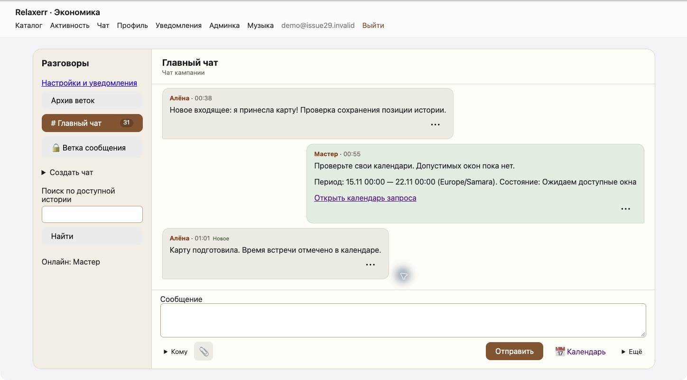
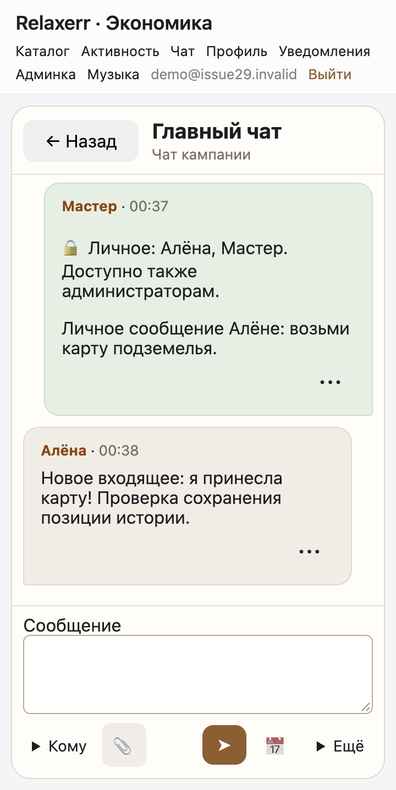
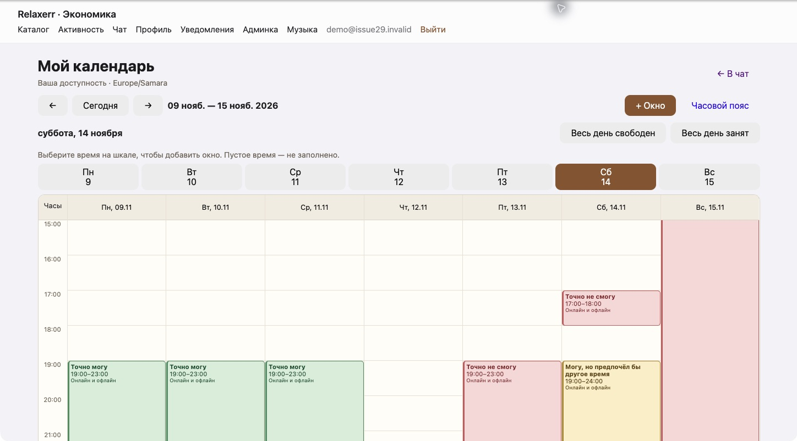
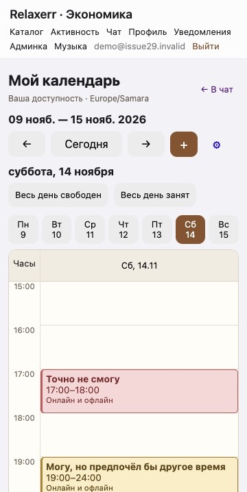

# Приёмка UX чата и календаря — issue #29

Проверено 14 ноября 2026 года. Ветка создана от актуального `origin/main`.
Текущие `/chat` и `/calendar` сначала просмотрены в работающем приложении.
Изменённая версия проверена локально в Chrome с отдельной БД `relaxerr_issue29`
и демонстрационными аккаунтами; рабочие календари и история не использовались.

## Проверки

| Сценарий | Результат |
|---|---|
| Новый вход в чат | Открываются свежие сообщения; история прокручивается отдельно от шапки и ввода |
| Отправка | Сообщение появляется справа, автор и местное время видны, поле очищается |
| Личное сообщение | Выбор адресата у ввода; в сообщении видны адресаты и доступ администраторов |
| Ветка | Создана из меню личного сообщения клавиатурой; сохраняет личный круг читателей |
| Поиск | Найдено сообщение №1 за пределами последних 50; переход загрузил и выделил его |
| Догрузка истории | После добавления старых сообщений сохранён видимый якорь — сообщение №29 |
| Новое входящее при чтении истории | Позиция сохранена; растёт непрочитанное, появляется кнопка «Новые сообщения»; кнопка открывает конец |
| Меню сообщения | Открывается нажатием; Tab переводит фокус на «Ветка», Enter открывает ветку; прочитавшие находятся внутри меню |
| Мобильная навигация | При ширинах 360 и 400 px список и разговор занимают отдельные экраны; видна кнопка «Назад» |
| Создание окна | Нажатие 14.11, 17:00 подставило 17:00–18:00; сохранённое окно появилось на шкале |
| Правка окна | Из сетки открыт тот же интервал; статус изменён на «Точно не смогу» |
| Повтор | Открыта вся недельная серия, кнопкой добавлен вторник; появился фактический интервал вторника |
| Разовое исключение | У пятничного повторения изменён статус только этого окна; понедельник, вторник и среда остались свободными |
| Через полночь | Интервал 14.11 19:00–15.11 02:00 отображался на обеих датах с обрезанными по дню границами |
| Весь день | Для выбранного воскресенья последовательно применены «свободен» и «занят»; новые разовые правила перекрыли прежнее окно |
| Запрос из чата | Запрос создан через «Ещё»; ссылка открыла 15.11 и выделенный период 15–21.11 с местным поясом |
| Адаптивность | Десктопная недельная сетка и мобильная шкала выбранного дня, горизонтального переполнения страницы не наблюдалось |

Мобильная проверка выполнена в responsive-режиме Chrome (360 и 400 CSS px),
с мышью и клавиатурой. Проверка на физическом телефоне не выполнялась.
В PR приложены снимки итоговой версии на десктопе и при 360 CSS px.
У снимков убрана рамка браузера; содержимое интерфейса не изменялось.

При сценарии запроса найден и исправлен прежний дефект Razor: строковый параметр
`SchedulingCard.Zone` получал литерал `preference.Zone`, а не значение настройки.

## Сборка и тесты

- `dotnet build --configuration Release --no-restore`: **0 ошибок, 0 предупреждений**.
- `DND_TEST_POSTGRES='<локальный сервер с CREATEDB>' dotnet test --configuration Release --no-build --no-restore`: **23 passed, 0 failed, 0 skipped**.
- `git diff --check`: без ошибок.

Добавлены проверки происхождения фактического интервала (серия/исключение),
переходов DST в ночном повторении и непрочитанного с учётом личных прав,
своих сообщений и отметки прочтения. Существующий интеграционный сценарий
PostgreSQL проверяет миграции, авторизацию/приватность, файлы, опросы,
уведомления, подбор партий, экономическую связь и повторный запуск.

Для первой сборки NuGet не смог записать кэш проверки уязвимостей вне sandbox.
Повторный restore с `NUGET_HTTP_CACHE_PATH` в `/tmp` устранил предупреждения.

## Скриншоты

| Экран | Десктоп | Телефон, 360 CSS px |
|---|---|---|
| Чат |  |  |
| Календарь |  |  |

Схема БД, правила доступа и подбора не менялись. Слияние и деплой не выполнялись.
